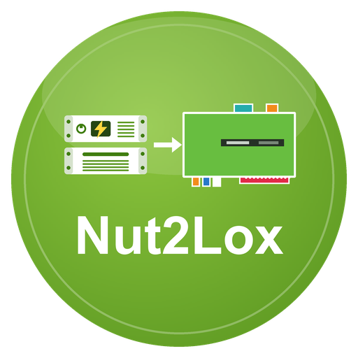

# Nut2Lox – LoxBerry-Plugin

**Version 0.8.3** · Benötigt LoxBerry 4 (PHP ≥ 7.4) · [Changelog](CHANGELOG.md)

Dokumentation: [docs/wiki/Home.md](docs/wiki/Home.md)

Liest USV-Werte von NUT-Servern (Network UPS Tools, Port 3493) und veröffentlicht sie per MQTT am LoxBerry-Broker (→ MQTT-Gateway → Loxone).
Optional richtet das Plugin auf dem LoxBerry selbst einen NUT-Server für eine USB-USV ein, auch für eine Synology DiskStation als Client. Ersetzt den ioBroker-Adapter `nut`.

## Installation
1. `bash build.sh` → `nut2lox-<version>.zip` (oder ZIP von den [Releases](https://github.com/ricten/Nut2Lox/releases))
2. In LoxBerry → Plugin-Verwaltung → ZIP installieren (holt die Pakete `nut-server`, `nut-client`, `usbutils`).
3. Plugin öffnen, Reiter „Einstellungen USV/NUT“:
   - USV an einem anderen Gerät: unter „NUT-Server im Netz“ Host eintragen, **Aktiv** anhaken, speichern.
   - USV per USB am LoxBerry: „Lokalen NUT-Server einrichten“ aktivieren, ggf. mit „USB-Geräte suchen“ die IDs ermitteln, speichern.
4. Reiter „Test“ → „Selbstprüfung“. Werte erscheinen unter `nut/<name>/*`. Die Topic-Tabelle steht im Reiter „Einbindung in Loxone“.

Umstieg vom früheren Plugin `nut` (bis 0.4.4): `nut2lox` zuerst installieren (übernimmt die Einstellungen), dann das alte Plugin deinstallieren. Die Topics bleiben gleich.

**Immer das neueste Release:** `https://github.com/ricten/Nut2Lox/releases/latest/download/nut2lox.zip` (ZIP ohne Version im Namen). **Automatische Updates:** Neue Installationen stehen in der Plugin-Verwaltung auf „Releases“, LoxBerry prüft täglich die `release.cfg` im Repository und installiert neuere Versionen selbst (Details: [docs/wiki/Installation.md](docs/wiki/Installation.md)).

## Topics (Auszug)
`nut/<name>/battery_charge`, `…/battery_runtime`, `…/ups_status`, `…/zustand/online|batterie|batterie_schwach|…` (0/1), `…/verbunden`, `…/info/*`, `nut/status/ok|zaehler|ts`.
Befehle (gesperrt bis zur Freigabe): `nut/befehl/<name>/beeper_toggle` = 1, Quittung unter `…/quittung`. Vollständige Liste: [docs/wiki/MQTT-Topics.md](docs/wiki/MQTT-Topics.md).

## MQTT-Broker
Standard ist der Broker des LoxBerry (Zugangsdaten verwaltet LoxBerry). Alternativ lässt sich im Reiter „MQTT“ ein eigener Broker (Host, Port, Benutzer, Passwort) eintragen.

## Lokaler NUT-Server
`bin/nut-apply.sh` (root, per sudo – die Erlaubnis kommt aus `sudoers/sudoers` des Plugins und wird vom LoxBerry-Installer unter `system/sudoers/` abgelegt) schreibt `/etc/nut/{nut.conf,ups.conf,upsd.conf,upsd.users}`. Betriebsart `netserver` ohne upsmon: der LoxBerry fährt bei leerer Batterie **nicht** selbst herunter.
Fremde Dateien werden einmalig als `*.vor-nut-plugin` gesichert. Deinstallation lässt `/etc/nut` und die Pakete bestehen. Details: [docs/wiki/Lokaler-NUT-Server.md](docs/wiki/Lokaler-NUT-Server.md).

### Synology als Client
Option „Synology (DSM) als Client“: DSM erwartet fest die USV `ups` und den Benutzer `monuser` / `secret` (Rolle slave, in DSM nicht änderbar).
Das Plugin benennt die USV dann `ups`, gibt den Server im Netz frei und legt `monuser` nur als Client an. In DSM: Systemsteuerung → Hardware & Energie → USV → „Synology USV-Server“ → IP des LoxBerry.
Quelle: https://www.bjoerns-techblog.de/2024/04/synology-diskstation-als-nut-client/

## Entwicklung
- Tests: `php tests/run.php` und `bash tests/test_apply.sh`
- Fake-Server: `php tests/fake_nut.php 13493`, `php tests/fake_mqtt.php 18830 <Ordner>`
- Details und Regeln: [CLAUDE.md](CLAUDE.md), [docs/wiki/Entwicklung.md](docs/wiki/Entwicklung.md)

## Lizenz
MIT, siehe [LICENSE](LICENSE).
