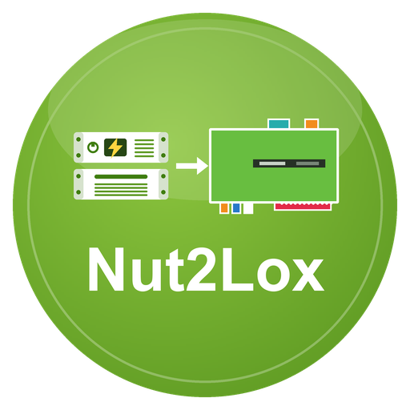

# Nut2Lox

**Nut2Lox** ist ein LoxBerry-Plugin, das die Werte einer USV (unterbrechungsfreie Stromversorgung) über das **NUT-Protokoll** (Network UPS Tools, Port 3493) ausliest und an den MQTT-Broker des LoxBerry veröffentlicht.
Über das LoxBerry-MQTT-Gateway gelangen die Werte an den Loxone Miniserver. Es ersetzt den ioBroker-Adapter `nut`.

## Was kann das Plugin?

- Liest bis zu **4 NUT-Server im Netz** (auch Server mit mehreren USVs) und veröffentlicht **alle** Variablen, die der Server liefert
- „Sprechende“ Topics wie `nut/usv/battery_charge`, `nut/usv/ups_load`, dazu Zustände als 0/1 (`zustand/batterie` = Netzausfall)
- Zusatzinfos des Servers unter `info/*`: Sofortbefehle, schreibbare Variablen mit Werten und Bereichen, Clients, Version
- Optional: richtet auf dem LoxBerry selbst einen **NUT-Server für eine USB-USV** ein, auf Wunsch auch für eine **Synology DiskStation als Client**
- **Befehle aus Loxone** (Piepser, Batterietest): ab Werk gesperrt, mit Quittung
- MQTT-Broker des LoxBerry oder **eigener Broker** (Host, Port, Benutzer, Passwort)
- Lebenszeichen `nut/status/ok|zaehler|ts` für die Ausfallerkennung in Loxone
- Weboberfläche mit Einstellungen USV/NUT, MQTT-Reiter, Erreichbarkeitsanzeige, Topic-Tabelle, Selbstprüfung und Log

## Seiten

1. [Installation](Installation.md)
2. [Konfiguration](Konfiguration.md)
3. [Lokaler NUT-Server](Lokaler-NUT-Server.md) (USB-USV am LoxBerry, Synology)
4. [MQTT-Topics](MQTT-Topics.md)
5. [Loxone-Anbindung](Loxone-Anbindung.md)
6. [Fehlersuche](Fehlersuche.md)
7. [Entwicklung](Entwicklung.md)

## Voraussetzungen

- LoxBerry ≥ 4.0 mit aktivem MQTT-Broker (Mosquitto) und MQTT-Gateway (oder eigener Broker)
- PHP ≥ 8.2 (Kommandozeile und Web). Das hat LoxBerry 4.0 auf Debian 13 (Trixie); auf Debian 11 und 12 ist meist PHP 7.4 aktiv, dann zuerst die Debian-Version anheben ([Anleitung im LoxBerry-Wiki](https://wiki.loxberry.de/installation_von_loxberry/upgrade_distribution/start)). Die Installation prüft das und bricht sonst mit einem Hinweis ab
- Ein erreichbarer NUT-Server **oder** eine USV per USB am LoxBerry

## Lizenz

MIT, siehe [LICENSE](../../LICENSE). NUT ist ein Projekt der [Network UPS Tools](https://networkupstools.org/); dieses Plugin ist inoffiziell.
